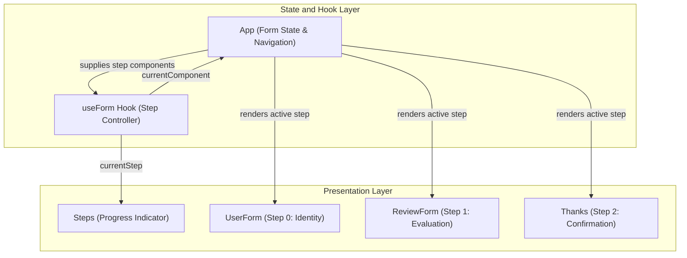

# Multi-Step Form React

A modular multi-step product evaluation form built with React 19 and Vite.

## Technology Stack

- Runtime and Bundler: Vite 7
- UI Library: React 19
- Icons: React Icons 5
- Code Quality: ESLint 10
- Styling: Plain CSS

## Getting Started

Follow these steps to set up and run the project locally.

### Prerequisites

Ensure you have Node.js (version 18 or higher) and npm installed on your machine.

### Installation

1. Clone or download the repository to your local machine.
1. Open your terminal and navigate to the project directory.
1. Install project dependencies:

```bash
npm install
```

### Running Locally

Start the Vite development server:

```bash
npm run dev
```

Open your browser and navigate to the local URL displayed in the terminal (typically `http://localhost:5173`).

## Key Scripts

The following npm scripts are defined in [`package.json`](./package.json):

- `npm run dev`: Starts the local development server with Hot Module Replacement (HMR).
- `npm run build`: Compiles and bundles production assets into the `dist/` directory.
- `npm run preview`: Boots a local static server to preview production build artifacts.
- `npm run lint`: Executes ESLint across project source files to verify syntax and code style.

## Architecture

The application implements a multi-step wizard pattern orchestrated by a dedicated custom React hook.
State is lifted to the top-level application container to ensure input values persist across step transitions.

### Workflow and State Architecture



### Project Structure

- [`src/App.jsx`](./src/App.jsx): Main application root storing customer review state and rendering wizard controls.
- [`src/hooks/useForm.jsx`](./src/hooks/useForm.jsx): Custom hook encapsulating step navigation index, boundaries, and active component selection.
- [`src/components/Steps.jsx`](./src/components/Steps.jsx): Progress indicator reflecting the active phase.
- [`src/components/UserForm.jsx`](./src/components/UserForm.jsx): Step 1 form capturing customer identification details.
- [`src/components/ReviewForm.jsx`](./src/components/ReviewForm.jsx): Step 2 form capturing satisfaction rating and feedback comments.
- [`src/components/Thanks.jsx`](./src/components/Thanks.jsx): Step 3 summary component displaying review details prior to submission.
